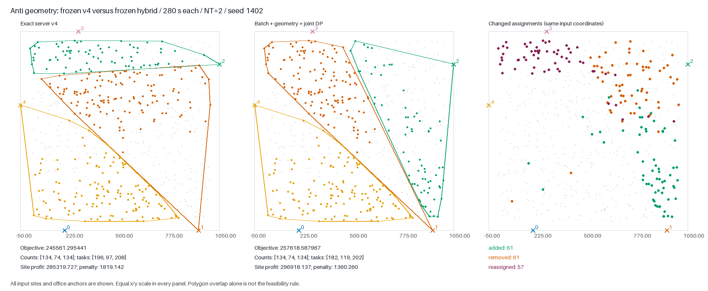
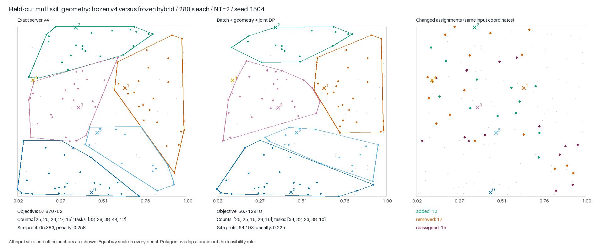

# Глубокое исследование v4: геометрия, поиск и совместный DP

Исследовательская ветка: `research/v4-local-search`. Изменения локальные: без commit,
staging, push, merge и серверных отправок. Основной отчёт и воспроизводимые
артефакты находятся в `experiments/v4_deep_parallel/`.

## База и методика

Первичная база — **точная замороженная серверная v4**, а не объединённый main:
SHA256 исходника `5b3914fa9791cb879f3232fb2876a915de83b848ad4b353b0dbf25b574998c25`.
Исходник, O3-бинарник и компилятор зафиксированы в `shared/BASELINE_READY.json`.

Две независимые лаборатории исследовали геометрию (`geometry/`, генератор 711000+)
и стратегии поиска (`search/`,721000+). Интеграция использует отдельные входы 731000+.
Диапазон 751000+ зарезервирован для проверки после окончательной фиксации кода.

На машине неоднородные ядра и SMT. Основные новые серии выполняются блоками:
все варианты одного `(case, solver seed)` идут на одной паре CPU, порядок
вариантов перемешан. Python-поток валидатора также закреплён за этой парой.
Ранний search-screen с раздельным распределением вариантов между разными
ядрами сохранён как exploratory; он не доказывает превосходство.

Все полные сравнения используют NT=2, O3, общий лимит времени. Снимки на 60/120/240 с
внутри запуска TL280 — диагностика одной траектории, не эквивалент отдельных
запусков с такими лимитами: бюджеты фаз зависят от полного TL.

## Геометрическое переразбиение

В исходном sweep двух зон есть две неполноты генерации предложений:

* TopSum сначала выбирает до `maxSize`, затем отклоняет результат по `A`.
  Между тем допустимое количество также ограничено численностью остальных зон
  и доступным количеством сайтов на другой стороне разреза.
* Свободный сайт попадает в пару только если его первый открытый офис по
  дорожной прибыли принадлежит этой паре. Это исключает полезные альтернативы.

Новый оператор ограничивает TopSum необходимыми верхними границами и расширяет
пул свободных сайтов, исключая точки, покрытые неподвижной третьей зоной.
Все окончательные проверки геометрии, навыков и численности сохраняются.
Для A=0 с неподвижными остальными офисами отдельный режим разрешает включать
отрицательные эффективные прибыли для поддержки необходимого количества сайтов.

Проверка cardinality-подзадачи выявила и исправила ошибку первого прототипа:
доступное количество другой стороны надо дополнительно ограничивать её
capacity и ограничением от остальных зон. Старый прототип и неуспешный oracle
сохранены. Отдельный exhaustive witness negative-padding имеет optimum135,
тогда как исходный polish останавливается на 130.

На зрелом anti native-проход нашёл 98,53% прироста, который затем независимо
подтвердили SCIP и HiGHS в окрестности 66 изменённых сайтов. Это оптимальность
**только ограниченной подзадачи**. На 600-секундном плато новый проход также
нашёл улучшение, недоступное обычному polish за тот же короткий дополнительный
бюджет. Полные данные — `geometry/REPORT.md`.

Глобальная замена resplit отвергнута: на 48 полных TL60 запусках варианты меняют
офисные наборы и дают существенные регрессии. В интеграцию переносится отдельный
финальный проход `solver/geometry_refine.h`, выключенный по умолчанию.

## Совместный выбор количества сайтов и нагрузки

`resize_dp` решает рюкзак по нагрузке задачами, а ограничение числа сайтов `A`
восстанавливает отдельный `repair_sizes`. Эта последовательность не является
точной совместной оптимизацией. Native witness на 6 сайтах:

| Этап | Целевая функция |
|---|---:|
| Исходное допустимое решение |65|
| Load-only DP, недопустимые counts2/3 |135|
| Последующее выравнивание counts |10|
| Совместный допустимый optimum, counts2/2 |110|

LNS и polish откатывают ухудшение, поэтому пример не доказывает потерю финального
ответа полного решателя. В конструкторе аналогичного отката не было; его влияние
проверено отдельной абляцией, без смешения с новым DP:24/24 успешных запуска,
mean+0,090%, median0, worst−5,285%. Guard не включён в итоговый кандидат.

`solver/joint_territory.h` строит для каждой существующей зоны таблицу
`f[count, task_load]`. Пул состоит из совместимых с фиксированным назначением
работников входных сайтов внутри её исходной оболочки. Перебор общего окна
количества `[c,c+A]` и окна нагрузки `[lo,hi]` оптимизирует обе связи одновременно;
зоны с отрицательным вкладом можно закрывать. Восстановление решения использует
битовую историю переходов 0/1 DP, в том числе для сайтов с нулём задач.

Это точная подзадача при полном завершении перебора, фиксированных исходных
оболочках и фиксированном сертификате работников; открытые зоны непустые.
Оболочки могут только сжиматься, поэтому новых общих входных точек не возникает.
Это **не** глобальный optimum и не свободное перераспределение работников.
Работа и память ограничены оценкой размера DP и числа окон; дорогие случаи
пропускаются. Все циклы ограничены дедлайном, изменение применяется только при
допустимости и положительном приросте.

Две MILP-модели внутри тех же оболочек, допускающие также перестановку работников,
независимо нашли на зрелом alphabig прирост 11007,487521. Native DP с исходным
сертификатом воспроизвёл его примерно за 0,011 с; на втором seed дал 16773,039045.
На anti он также воспроизвёл найденный MILP прирост. Это операторные результаты
на фиксированных снимках; итоговый эффект при общем лимите проверен отдельно ниже.

Независимый native oracle32/32 совпал с перебором. Первоначальный oracle ошибочно
разрешал назначить незанятого работника в зону без задач, тогда как native держит
свой заново вычисленный сертификат фиксированным. Этот отрицательный результат
сохранён, область сравнения исправлена, runtime-код не менялся ради этого теста.

## Ускорение и инвариант состояния

Batch-удаления откладывают перестройку оболочек до конца пакета, включая rollback.
Лабораторный differential oracle сравнивает полное состояние, а не только score.
На фиксированных одинаковых операциях подтверждено ускорение ядра в 3,6–4,0 раза.
Это не равнозначно ускорению всего решателя или гарантии качества при time limit.

Отдельно исправлен `Sol::close_office`: он не обновлял `sig_open(o)`, хотя прямой
путь вызывается из DP. До исправления direct close/reopen не совпадал с сигнатурой
полного `load_state`, после совпадает. Практическая ошибочная feasibility из-за
этого нарушения не доказана. Расширенная проверка состояния выполняет 27908
проверок по четырём комбинациям exact/legacy и spatial index.

## Экспериментальные переключатели

| Переключатель | Назначение | По умолчанию |
|---|---|---:|
|`GEOM_TAIL`|Биты 1/2/4: count caps, expanded pool, парные caps;8: negative padding|0|
|`GEOM_SECONDS`|Максимальная часть имеющегося финального времени для геометрии|1|
|`JOINT_TERRITORY`|Совместный count/load DP внутри исходных оболочек|0|
|`JOINT_SECONDS`|Максимальная часть имеющегося финального времени для DP|1|
|`HYBRID_ORDER`|0: geometry→joint→boundary;1: joint→geometry→joint→boundary;2: boundary→geometry→joint|0|

Ранее существующие исследовательские переключатели сохраняются. Runtime не
использует SCIP/HiGHS, внешние данные, сохранённые старты или межтестовый кэш.
Серверный стандартный лимит остаётся 280 с. Независимые quality-таблицы и статус
итогового кандидата — в отчёте интеграции, не выводятся из microbenchmark.

## Что дало объединение операторов

На 12 одинаковых зрелых checkpoint проверены три финальные стадии с одинаковым
бюджетом 3 с, NT2 и закреплёнными CPU. Все 36 процессов успешны. Исходный boundary
и boundary с batch пришли к одинаковым ответам. Geometry→joint→boundary получил
6 побед,6 совпадений и 0 проигрышей: mean+0,897%, median+0,086% относительно
исходного boundary. Это операторное сравнение с фиксированного состояния,
а не доказательство превосходства полного решателя.

На anti новый финальный проход перестраивает разделение территорий существенно:
в полном TL280 сравнении изменены 179 назначений, включая 61 новый и 61 снятый
сайт,57 переносов между офисами. Набор офисов и counts134/74/134 остаются теми же.
Прирост прибыли сайтов 11598,410 и уменьшение штрафа 458,883 вместе дают 12057,293.
Большая часть выигрыша связана с выбором сайтов и границей, а не только с балансом.

Полный development TL280 на 6 входах ×2 новых seed:24/24 успешных процесса,
mean+0,8896%, median+0,0297%, W/T/L6/4/2, худший−0,9610%. Обе anti-пары
выигрывают≈4,9%, но отдельные alphabig/huge-пары проигрывают. Этот результат
не проходит буквальный критерий отсутствия регрессий.

Код отдельного кандидата зафиксирован до генерации 12 новых holdout-входов.
В его ZIP geometry и joint включены по умолчанию, хотя в модульном solver
остаются opt-in. Повторная сборка ZIP совпала с frozen runtime после исключения
служебной таблицы символов и build-id; исходники совпадают побайтово.
Пройдены 28 синтетических и 6 файловых проверок. Независимый аудит обнаружил
только два ограничения качества у дедлайна DP: потеря промежуточного best и
повторный поиск уже известного worker certificate. Они не нарушают допустимость;
замороженный кандидат после начала holdout не изменяется.

## Проверка новых входов на полном лимите

Независимое подтверждение TL280 завершилось 12/12 успешными процессами на 6 новых
входах. Среднее парных изменений−0,1765%, медиана+0,0684%, W/T/L3/0/3;
худший результат−2,0007% на multiskill. Остальные проигрыши: huge−0,6381%,
tightA−0,0156%. Положительный development не заменяет этот отрицательный результат.
**Устойчивое превосходство над v4 не доказано; критерий принятия не выполнен.**

Во всех трёх проигрышах наборы открытых офисов совпадают. На multiskill хуже
выбраны сайты внутри другого разбиения: прибыли потеряно 1,1900 при экономии
штрафа 0,0322. На huge финальная геометрия улучшает 5194,7838→5205,5012, но
предыдущая траектория оставляет отставание от v4=5238,9331. Это локализует
проблему раньше нового хвоста, но не позволяет единолично обвинить batch,
кодогенерацию, сигнатуру, тайминги или взаимодействие потоков.

Кандидат остаётся отдельным экспериментальным ZIP; базовый архив v4 не изменён.
Новые операторы доступны в модульном solver под флагами. Никакой подстройки по
holdout и никаких коммитов, staging, push, merge или отправок не выполнялось.

## Итоговые полные сравнения замороженного кандидата

Все 128 запусков четырёх основных серий успешны: official validator, rc, NT2,
порог wall≤TL+3 и stderr-проверки. Пиковый RSS кандидата 28,02 MiB; максимальный
wall полного TL280 —279,545 с. Независимый агент повторно проверил пары,
manifest-хеши и отсутствие пересечения solver-процессов на одинаковых CPU.

| Серия | Пар | Среднее Δ% | Медиана Δ% | Худшая Δ% | Победы / равенства / проигрыши |
|---|---:|---:|---:|---:|---|
| Новые входы, TL60 | 36 | +0.1332 | +0.0000 | -1.5799 | 14 / 12 / 10 |
| Новые входы, TL280 | 6 | -0.1765 | +0.0684 | -2.0007 | 3 / 0 / 3 |
| Development, TL280 | 12 | +0.8896 | +0.0297 | -0.9610 | 6 / 4 / 2 |
| Открытые, TL60 (первые 2 seed) | 10 | -0.0880 | +0.0000 | -4.5190 | 1 / 8 / 1 |

Primary holdout —12 новых экземпляров ×3 solver seed, а не 36 независимых
экземпляров. Подтверждение TL280 повторяет 6 из этих новых входов с новым seed.
Кандидат зафиксирован до генерации данных и после анализа не менялся.
Полные абсолютные значения, разброс, лучшие/худшие пары, времена/RSS:
[таблица](https://github.com/mannobody/techarena2026-service-zone-optimization/blob/ffe5018957b1e3405a7448c8d27057272429cd67/experiments/v4_deep_parallel/integration/RESULTS_TABLE.md).

Сохраняются две полезные независимые находки: быстрый joint count/load DP и
геометрическая перестройка, которая совместно с прежним boundary даёт новый
сильный переход между разбиениями. Усиление этих отдельных подзадач не
превратилось в устойчивое превосходство полного решателя. Базовая v4 сохранена;
ZIP явно экспериментальный, новые модульные проходы выключены по умолчанию.

Дополнительная проверка inst4 расширена до 6 seed без изменения кода. Все 12
процессов успешны; W/T/L4/0/2, mean+0,7125%, отношение медиан+0,1786%,
SD3,1888%, диапазон−4,5190%..+4,4096%. Разброс остаётся существенным; это
диагностика одного известного входа, а не новый независимый holdout и не
доказанное исправление исторической регрессии относительно e600dde.

Сохранённые файлы и необязательные воспроизводимые копии перечислены в
[инвентаризации](https://github.com/mannobody/techarena2026-service-zone-optimization/blob/ffe5018957b1e3405a7448c8d27057272429cd67/experiments/v4_deep_parallel/INVENTORY.json) и
[списке кандидатов на очистку](https://github.com/mannobody/techarena2026-service-zone-optimization/blob/ffe5018957b1e3405a7448c8d27057272429cd67/experiments/v4_deep_parallel/CLEANUP_CANDIDATES.md).
Ничего не удалено.

Разброс pooled inst4 включает различия seed, CPU-пар и тайминга; это не чистая
оценка влияния seed. Аппаратура совпадает внутри каждой A/B-пары.
