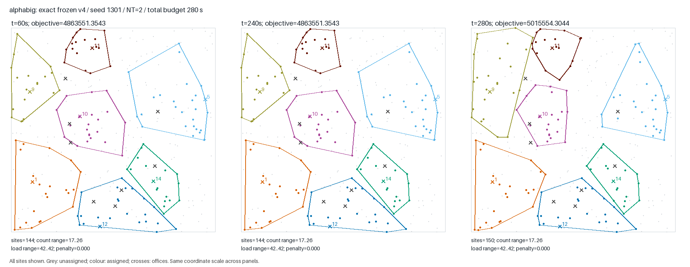
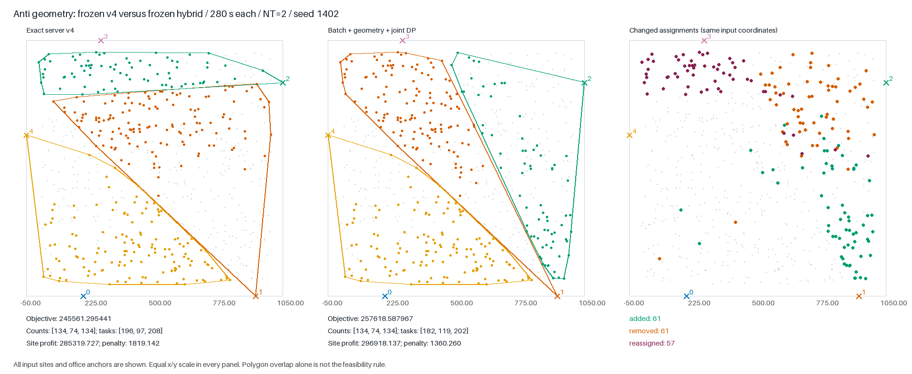
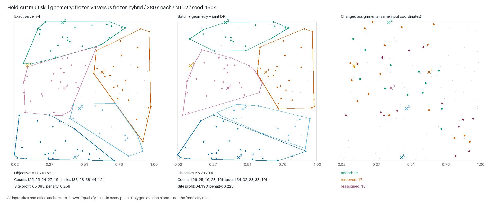

# Integrated investigation against frozen server v4

**Final candidate status: experimental; not promoted.** The independent TL280
holdout has mean−0.176472% and a−2.000740% worst pair. Useful new operators are
implemented and verified, but robust full-solver superiority over v4 is not
established. The frozen v4 ZIP is preserved and modular new-tail defaults stay
off. Full distributions: [RESULTS_TABLE.md](RESULTS_TABLE.md).

This round combines two independent laboratories with a third integration and
oracle investigation. All changes are local. No staging, commit, push, merge,
submission or deletion was performed. The baseline server ZIP remains unchanged.

## What was actually combined

The frozen experimental candidate contains the exact server-v4 source plus:

1. Deferred hull/coverage maintenance across batch removals and rollback.
2. The missing `sig_open(o)` update in direct office closure.
3. A bounded final geometric repartition pass with necessary count caps,
   an expanded free-site pool, and optional negative count-support sites at A=0.
4. A joint site-count/task-load dynamic program inside existing convex hulls,
   keeping a feasible worker certificate fixed.

The selected final order is geometry → joint DP → existing boundary search.
Each new pass can use at most one second of the time already left after the
original finalization. It does not extend the overall deadline. No constructor
guard, ALNS, persistent archive, niche crossover, worker-certificate memo, or
expanded start scheduler is enabled in this candidate.

`src/hybrid_frozen.cpp`, `FINAL_FREEZE.json`, and `PACKAGE.json` identify the
source and binary exactly. The separate experimental ZIP enables the two new
passes by default; the modular working solver retains opt-in defaults. The ZIP
contains only `main.cpp` and `Makefile`, uses O3/C++17, and defaults to 280 seconds.
SCIP and HiGHS are offline research tools, never runtime dependencies.

## Comparison design

The baseline is the exact frozen server v4, not the already modified modular
working solver. Its source SHA256 is
`5b3914fa9791cb879f3232fb2876a915de83b848ad4b353b0dbf25b574998c25`.
`../shared/BASELINE_READY.json` records compiler and binary provenance.

The geometry lab uses generator seeds 711000+, the search lab 721000+, and this
integration lab 731000+. Final holdout seeds 751000+ were reserved before
experiments and are generated only after candidate source/binary freeze.
`DEVELOPMENT_INPUTS.json`, `PREREGISTRATION.json`, and `FINAL_FREEZE.json` give
the exact parameters and selection history.

Each complete (instance, solver seed) block runs all compared variants on the
same CPU pair, in randomized order. Validation is pinned to the same pair.
This matters because this machine has both SMT performance cores and separate
efficiency cores. Full-machine power/frequency variation is not isolated.
NT=2 and O3 are common to all quality runs. A valid checkpoint does not rescue
a crash or timeout. Accepted runs require rc=0, official validation, no error
marker, two actual threads, and wall ≤ TL+3 seconds. Emergency kill is TL+10.

Percentages are paired changes relative to each v4 objective. They are
descriptive, not estimates of hidden-test leaderboard score. Zero-reference
pairs are reported separately and excluded from percent means. W/T/L uses an
absolute tolerance of 1e-9 × max(1, |baseline|). Per-class median objectives and
all individual pairs are retained in machine-readable summaries.

## Development ablations

`HYBRID_DEV60_SUMMARY.json`: six instances, one seed, six variants; **36/36**
successful full runs. Each variant has six paired comparisons. This small
development screen selects an integration order; it cannot establish general
superiority.

| Variant | Mean Δ% | Median Δ% | Worst Δ% | Best Δ% | W/T/L |
|---|---:|---:|---:|---:|---|
| Batch/signature only | +0.53193 | +0.00116 | −1.47939 | +4.57777 | 3/2/1 |
| Plus geometry | −0.24921 | +0.00116 | −1.54773 | +0.02524 | 3/2/1 |
| Plus joint DP | −0.67788 | −0.41282 | −1.70735 | +0.02565 | 2/1/3 |
| Geometry → joint | +0.74059 | 0 | −1.58781 | +4.01850 | 2/2/2 |
| Joint → geometry → joint | −0.14134 | 0 | −1.67081 | +0.83039 | 2/2/2 |

The frozen candidate is the geometry → joint order. Its actual compiled source
with defaults enabled is used in the subsequent TL280 and holdout comparisons;
the package is not a later untested source transformation.

An independent constructor rollback guard was also tested. Load-only DP can
produce an infeasible count pattern and subsequent `repair_sizes` can lose
objective; LNS/polish already roll back such losses, while construction did not.
The guard screen completed **24/24** runs: mean +0.09006%, median 0,
worst −5.28521%, W/T/L 4/6/2. Several divergent runs never activated the guard,
so timing/code-layout and basin effects cannot be attributed solely to the
guard's semantics. This does not justify enabling it. The earlier interrupted
coordinator (exit 143, zero completed rows) is preserved in `RUN_INTERRUPTION.json`
and excluded; the repeat uses the same inputs, seeds, and binaries.

## Joint count/load mechanism and independent oracles

The six-site native witness in `COUNT_LOAD_COUNTEREXAMPLE.json` has objective
65 initially. Load-only DP proposes 135 with counts 2/3; repairing counts gives
10. Joint optimization gives the feasible optimum 110 with counts 2/2. The full
solver can find 110 through other moves, so this is a structural subproblem
counterexample, not proof of an incorrect final solver result.

The new DP enumerates common count and task-load windows, with optional office
closure and a fixed feasible worker certificate. Candidate sites lie inside
the original zone hulls; new hulls only shrink. Exactness is restricted to this
family and requires completion of the bounded enumeration. It is not a global
optimum and does not optimize worker reassignment. Work and memory guards skip
oversized subproblems. Partial work never applies an invalid or worse state.

Two different MILP backends agreed with brute force on **32/32** tiny restricted
territory cases. The independent native DP oracle agreed on **32/32** cases.
The first native oracle's case 22 allowed extra workers in an originally
task-free zone, unlike the fixed-certificate runtime model. Its failed result
and correction are preserved in `JOINT_ORACLE_CORRECTION.json`; the runtime was
not changed to conceal the mismatch.

On mature TL280 v4 checkpoints, all **12/12** native postchecks were valid and
monotone. Important gains:

| Checkpoint | Native gain | Approximate native post time |
|---|---:|---:|
| alphabig / 1301 | 11007.487521 | 0.011s |
| alphabig / 1302 | 16773.039045 | 0.011s |
| anti / 1301 | 45.789736 | 0.31s |
| anti / 1302 | 34.054359 | 0.31s |

Both SCIP and HiGHS independently found the first alphabig and anti gains while
also permitting worker reassignment. For alphabig, four site selections change,
the worker teams remain unchanged, and all active offices keep load 42. The
other eight native postchecks have zero gain; large/huge often hit the work
guard. The MILP on large can improve 236.5263 in its 45-second diagnostic budget;
that expensive result is not advertised as a native runtime capability.

Relaxed LP results, where optimal, are upper bounds only for the fixed office
set after dropping geometry and integrality. They are not global optimality
gaps of the original problem. Raw solver statuses and timing are retained under
`logs/territory_mature/`.

## Long trajectories and geometry

All **12/12** baseline TL280 trajectories validate. `ANYTIME280.json` and
`figures/METRICS.json` record objective and assignment changes at 60, 120, 240,
and completion. The late alphabig improvement is +3.1253% / +2.3921% after 240s;
multiskill is flat in both seeds. These are snapshots of a TL280 run, not
independent TL60-versus-TL280 quality comparisons: phase budgets depend on TL.



The geometry lab additionally ran v4 for 600 seconds on anti: the same incumbent
persisted through 450s and until the final stage. The original boundary pass
improved 304.7695; afterward the new geometric pass gained another 939.2866
in about 0.118s, while ordinary polish gained zero. On a separate mature
checkpoint, native repartition obtained 98.53% of the gain independently proved
by both SCIP and HiGHS in a selected 66-site neighborhood. Both exact models
required about 63–65 seconds. These are conditional mechanism findings on
development instances, not evidence of a universal solver advantage.

## Correctness and package checks

The batched kernel has **24,000** differential transactions / **96,000** full
state checks from the search lab. Its measured 3.60–4.04× speedup concerns fixed
remove/undo work, not total runtime or final objective. The separate signature
fix is verified against independent full-state reconstruction; practical invalid
solutions from the old signature alone have not been demonstrated.

The composed kernel passes **27,908** checks over exact/legacy geometry and
spatial-index on/off. Combined and modular synthetic suites each complete
**28/28** valid processes within time. Two empty/no-office cases intentionally
return before printing the thread count; the raw runner marks them unsuccessful
for missing NT evidence. Dedicated audit files explain this classification
without changing raw records. No crash or TLE is reclassified as success.

The exact ZIP was also independently rebuilt and passed 28/28 synthetic and
6/6 no-argument file-contract checks. Raw binary hashes differ because the
source basename is main.cpp; after removing symbol-table/build-id metadata,
compiled binaries are byte-identical. Source files are identical before that
normalization. `PACKAGE_BUILD.json` records both raw and normalized hashes.

## Reproduction and retained failures

Run from the repository root. The quality runner accepts a JSON spec:

```
.venv/bin/python experiments/v4_deep_parallel/shared/run_blocks.py NEW_SPEC.json
python3 experiments/v4_deep_parallel/integration/summarize.py NEW_LOG_DIRECTORY NEW_SUMMARY.json
```

Copy an existing spec and give it a new destination before rerunning; existing
run directories are immutable and the runner refuses to overwrite them.
`HYBRID_280.json` and the final holdout specs record exact binaries, seeds, and
CPU pairs. Do not run independent benchmarks on overlapping CPU pairs.

All compile errors, incomplete series, corrected oracle domains, rejected
variants, intermediate sources, and logs remain available. There is no automatic
cleanup. Final quality results and the promotion decision are recorded below.

## Independent static audit of the frozen composition

The geometry agent reviewed the combined source without modifying it. No P0/P1
was identified. Two P2 quality limitations remain: the joint DP discards a
found candidate on reaching its local deadline, and publication rechecks worker
assignment instead of reusing the fixed feasible certificate. Consequently a
valid improvement can be lost when restoration consumes the last local time.
Both paths preserve the old valid incumbent. These are recorded in
`STATIC_AUDIT.json`; they were not patched into an already frozen benchmark.
A future version would need a reserved reconstruction budget and independently
checked certificate publication, followed by new comparisons.

## What the conditional bounds say about remaining search

The LP keeps **exactly the incumbent open-office set**, with every one of these
offices mandatory. It therefore does not bound variants that open **or close**
an office. Geometry and integrality are relaxed. The relative number below is
(upper bound − incumbent) / |incumbent|, not a global solver optimality gap.

| Case | Incumbent | Optimal LP bound | Relative headroom |
|---|---:|---:|---:|
| alphabig | 5015554.304425 | 5381360.612369 | 7.2934% |
| anti | 245561.764079 | 345316.293317 | 40.6230% |
| huge | 7988.993491 | no certified bound (time limit) | — |
| large | 3250436.469929 | 3469512.316489 | 6.7399% |
| multiskill | 68512.710124 | 68593.832746 | 0.1184% |
| tightA | 23.075703 | 23.157334 | 0.3538% |

On this mature multiskill instance, improving assignments while preserving the
exact open set has less than 0.12% headroom even without geometry/integrality.
A large improvement there must therefore change the office set. On anti the
relaxation is much looser; it does not establish that its apparent headroom is
geometrically realizable. This prioritizes different mechanisms by structure,
without introducing any instance-ID branch in the runtime.

## Equal-budget final-stage causal comparison

After source freeze, `check_tail_competition.py` compared three final stages
starting from exactly the same twelve mature v4 checkpoints. Each gets three
seconds after loading/publication, NT=2, the same CPU20/21 pair, randomized
variant order within the checkpoint, and post seed1601. This diagnostic does
not alter candidate selection or its frozen source.

All **36/36** processes passed validation, return, and wall checks. Original-v4
boundary and batch-only boundary reached identical objectives in all twelve
cases. Geometry→joint→boundary versus original boundary: **6 wins, 6 ties,
0 losses**, mean +0.89719%, median +0.08636%, maximum +4.89323%. This is a
restricted checkpoint-stage result, not the full solver holdout.

| Checkpoint | Original boundary gain | Combined stage gain | Extra gain |
|---|---:|---:|---:|
| alphabig1301 |21550.113708|31455.784457|9905.670748|
| alphabig1302 |9760.315597|26533.354642|16773.039045|
| anti1301 |39.003562|12056.823888|12017.820326|
| anti1302 |27.268185|12045.088511|12017.820326|
| large1302 |0|5607.101409|5607.101409|
| huge1301 |0|21.909803|21.909803|

The other six checkpoints tie at zero gain. The full280 anti pair reaches the
same improved endpoint independently from two search seeds. For seed1402,
final v4→hybrid changes179 site assignments:61 new sites,61 removed sites,
and57 sites reassigned between offices. Open offices and counts134/74/134 stay
the same. Site profit rises11598.409756; imbalance penalty falls458.882770;
total gain12057.292526. The trace observes a large geometric gain before final
refinement, so this result is not attributed solely to batching.



The figure uses all input sites/office anchors and identical coordinate scales.
`figures/ANTI_HYBRID_280.json` records decomposition, changed site sets, and input/
solution hashes. `TAIL_COMPETITION_SUMMARY.json` retains every paired stage result.

## Completed full TL280 development comparison

All24/24 processes succeeded on six development instances and two fresh solver
seeds1402/1403, with the exact frozen default-enabled candidate. This is not the
independent input holdout. Mean paired change is +0.889617%, median +0.029748%, worst -0.960960%, best +4.910095%, W/T/L 6/4/2.

| Class | Baseline median | Candidate median | Ratio of medians Δ% | Worst pair Δ% |
|---|---:|---:|---:|---:|
| alphabig | 4971789.004555 | 4984814.671664 | +0.261992 | -0.138926 |
| anti | 245574.494407 | 257618.587967 | +4.904456 | +4.898818 |
| huge | 7802.410957 | 7807.080901 | +0.059853 | -0.960960 |
| large | 3256515.380005 | 3259054.968276 | +0.077985 | +0.059496 |
| multiskill | 68512.710124 | 68512.710124 | +0.000000 | +0.000000 |
| tightA | 23.075703 | 23.075703 | +0.000000 | +0.000000 |

The two anti seeds independently reach the same hybrid endpoint. Alphabig and
huge still contain losing pairs, so even this positive mean is not a strict
non-regression result. The independent holdout is evaluated without modifying
this source or defaults.

## Independent input holdout at TL280: promotion rejected

All12/12 runs succeeded, but the six paired held-out instances give mean
**−0.176472%**, median+0.068371%, and W/T/L**3/0/3**. Gains: alphabig+0.798845%,
large+0.644466%, anti+0.152306%. Losses: multiskill−2.000740%, huge−0.638144%,
tightA−0.015564%. The frozen hybrid therefore does **not** establish a robust
improvement over v4, and fails the no-regression acceptance requirement.
The positive development280 result is not substituted for this holdout.

For all three losing pairs, the final open-office sets are identical between
v4 and hybrid. The loss is therefore not explained by merely selecting a
wrong number or set of offices. On multiskill the hybrid enters the geometric
tail already at56.712918 and leaves unchanged, versus v4's57.870762. It serves
111 rather than116 sites:12 additions,17 removals,15 reassigned sites. Site
profit loses1.190049 while the balance penalty improves0.032206. On huge the
geometric tail actually improves5194.783838→5205.501207, but remains below
v4's5238.933134. A useful final operator does not erase a worse earlier
trajectory. These observations locate the deficit before the new tail;
they do not isolate batching versus code layout, timing, cache/signature
changes, or stochastic thread interaction as the unique cause.



`HOLDOUT_LOSSES_280.json`, the raw stderr, and
`figures/MULTISKILL_HOLDOUT_LOSS_280.json` preserve the decomposition and
assignment differences. No runtime branch, coefficient, or candidate source
was changed after examining these holdout losses.

## Primary holdout and open examples completed

The independent primary holdout completed72/72 successful runs on12 fresh
instances × three solver seeds. Mean+0.133173%, median0%, worst−1.579876%,
W/T/L14/12/10. Cluster improves in all three pairs, but alphabig loses all
three, and multiskill's ratio of medians is−1.161532%. This small positive
mean does not overcome the observed regressions or the negative TL280 holdout.

The initial open-example check completed20/20 successful runs, mean−0.087969%,
median0%, W/T/L1/8/1. Inst0–3 tie in all pairs; inst4 varies from+3.639317%
to−4.519009%. This is a comparison against exact server v4, not a reproduction
of the historical merged-main-versus76d51ba regression. A separately registered
four-seed follow-up expands inst4 to six seeds without changing the candidate.
The original20 records stay separate; no reweighting of the primary holdout.

Across the four main series,128/128 runs pass, actualNT2 is confirmed in every
run, and the candidate peaks at28.02MiB RSS. Maximum candidate TL280 wall is
279.545s. `RESULTS_TABLE.md` and `FINAL_RESULTS.json` contain all paired and
per-class distributions, standard deviations, process errors, runtime and RSS.
`../search/INTEGRATION_AUDIT.md` independently checks completeness, exact pair
keys, immutable provenance, affinities and absence of overlapping solver
intervals on the same CPU. Supplemental build provenance is in
`BUILD_PROVENANCE.json`; the original freeze file was not edited afterward.

**Decision:** retain the experimental artifact and opt-in implementations;
do not promote it over frozen v4. The two new structural operators and batch
kernel are useful research results. The current combination fails the explicit
no-regression acceptance condition. No commit, push, merge or submission is
part of this decision.

## Supplemental inst4 variance check (six seeds)

The four additional seeds completed8/8 successfully, giving12/12 successful
processes across six seeds on this one known open instance. Mean paired change
+0.712537%, paired median+0.544035%, ratio of objective
medians+0.178612%, SD3.188839%,
W/T/L4/0/2. Range-4.519009% to+4.409634%.
This confirms substantial variability, not a robust regression fix. The extra
seeds were registered after the first two outcomes; they are a supplemental
variance diagnostic, not another independent holdout. Source/defaults remain
unchanged. The original128 main-series rows and these8 follow-up rows are
reported separately. Raw pairs: `INST4_POOLED6.json`.

The pooled inst4 spread includes different CPU pairs and timing conditions as
well as solver seeds; it is not a pure estimate of seed variance. Hardware is
matched within each A/B pair.
